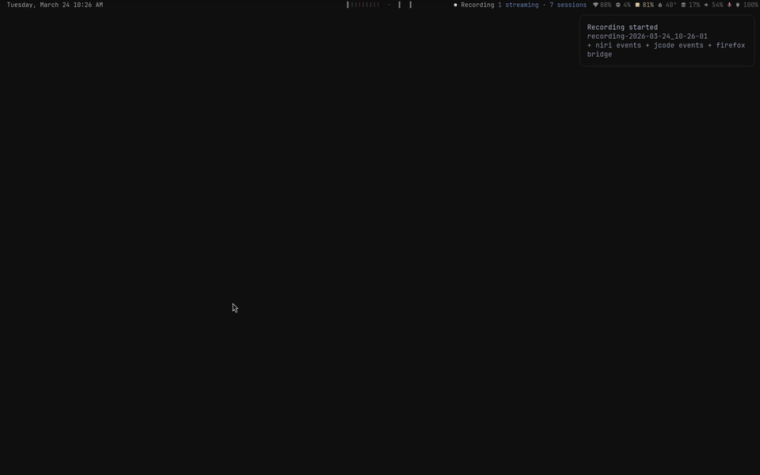

# niri-windows-waybar-preview

A fast, event-driven window preview grouped by workspace for [Waybar](https://github.com/Alexays/Waybar) and [niri](https://github.com/YaLTeR/niri).



## Features

- **Visual bars instead of numbers** — each window is rendered as a colored bar.
- **Event-driven daemon mode** — keeps a persistent niri socket connection and emits JSON updates only when workspace/window state changes.
- **App-aware coloring** — built-in colors for Chrome (red), Firefox, Discord/Vesktop, Spotify, Todoist, Gmail, and terminals.
- **Terminal app detection via `/proc`** — detects `jcode`, Claude, Codex, and Neovim/Vim running inside terminal windows.
- **Jcode status colors**: cyan means running, red means blocked, and green means done.
- **Terminal support** — works with Alacritty, Kitty, Ghostty, Foot, and Footclient.
- **Focus semantics** — uses `█` for the focused window, `▌` for the active window on an unfocused workspace, and `|` for other windows.
- **tmux hinting** — uses `¦` for non-focused tmux windows.
- **Cleaner empty workspace handling** — unfocused empty workspaces are hidden; a focused empty workspace is shown as a dim `·`.
- **Named workspace support** — shows the custom workspace name when that workspace is focused; tooltips include only non-empty workspaces.
- **Safer terminal PID detection** — skips `/proc` descendant inference for shared terminal PIDs in cases that can otherwise cause false positives.

## Benchmarks

| Metric | Value |
|--------|-------|
| Memory | 2.5 MB RSS |
| CPU per update | ~1.1ms |
| 80 rapid switches | ~90ms total CPU |

### Comparison

| Approach | CPU per update |
|----------|---------------|
| Bash script | ~340ms |
| Rust + signal | ~12-14ms |
| Rust daemon | **~1.1ms** |

The daemon is **~10-12x faster** than the signal-based approach and **~300x faster** than the original bash script.

## Installation

The source crate remains in `files/rs/niri-workspaces-rs`; the public binary is `niri-windows-waybar-preview`. Run these commands from that crate directory:

```bash
cargo build --release
cp target/release/niri-windows-waybar-preview ~/.config/waybar/
```

If Waybar is already running, restart Waybar or reload the module so the new binary is picked up.

## Waybar Configuration

```json
"custom/niri-windows-preview": {
    "exec": "~/.config/waybar/niri-windows-waybar-preview",
    "return-type": "json",
    "format": "{}",
    "escape": false
}
```

No `interval` or `signal` is needed. The daemon outputs JSON whenever relevant niri events occur. Use `#custom-niri-windows-preview` as the CSS selector.

## License

MIT
